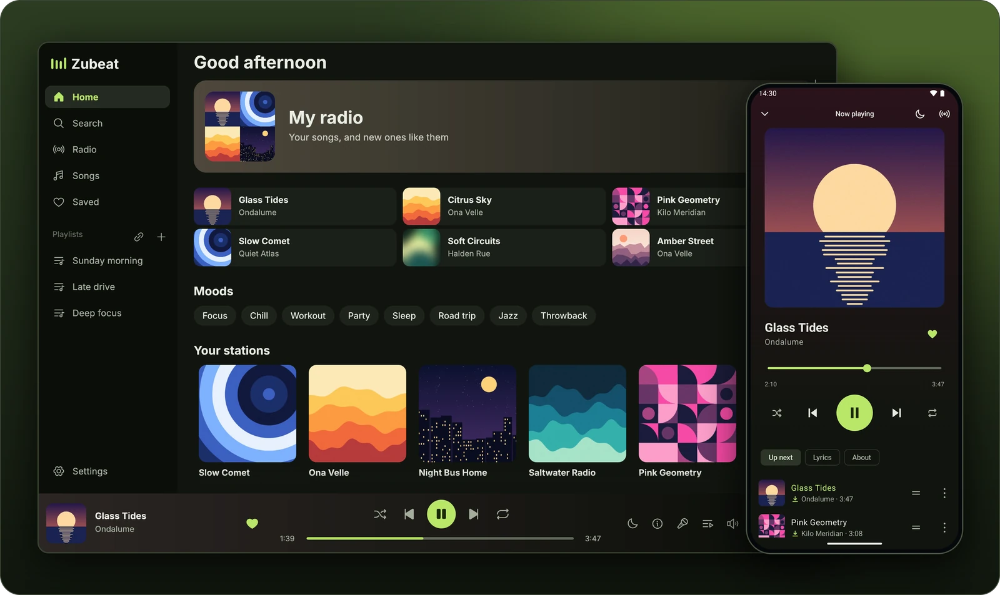
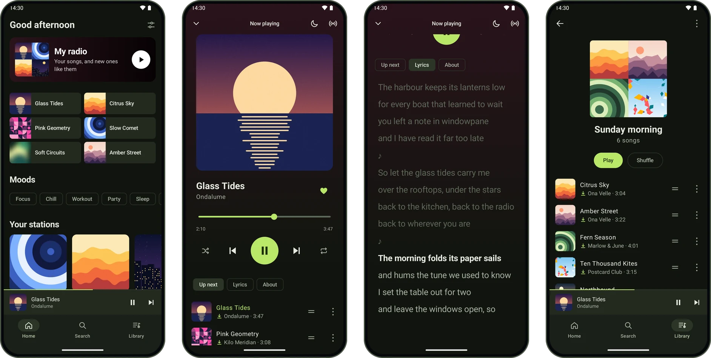
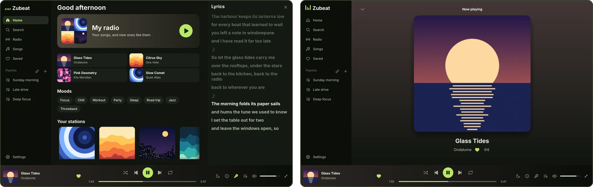
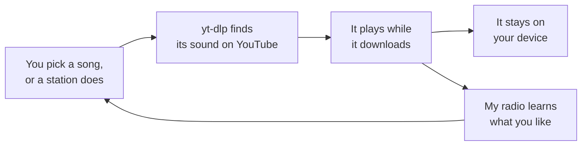

<picture>
  <source media="(prefers-color-scheme: dark)" srcset="images/wordmark-dark.svg">
  
</picture>

### Press play. Zubeat does the rest.

A music player for Android, Windows and Linux. 
Songs start while they download, stay on your device, and lead to more like them.

&nbsp;
&nbsp;

Free · No ads · No account · 30 languages

## What is Zubeat?

Zubeat is a music player that finds songs on YouTube and plays them as music: without video, with the screen off, and
without a connection once you have played them. Search for a song, share one from Shazam or any music app, or bring your playlists along. From there it can go on by
itself, with a radio that learns from what you play, like and skip.

There is no server behind it and nothing to sign up for. Your playlists, your history and your songs are on your own device.

## What it does

<table>
<tr><td width="170"><b>Plays at once</b></td><td>A song starts while it is still downloading. The next ones are fetched early, so they start without a pause and survive bad signal.</td></tr>
<tr><td width="170"><b>Works offline</b></td><td>You say how much space Zubeat may use, and it fills it by itself: with your saved songs, the queue, your playlists and songs you may like. Without a connection, My radio, stations and search go on with what is there. Over mobile data only if you want that, and what you save with the heart is never removed.</td></tr>
<tr><td width="170"><b>My radio</b></td><td>A station of your own: songs you love, mixed with new ones like them. It gets better the more you listen.</td></tr>
<tr><td width="170"><b>Radio from anything</b></td><td>Any song, artist or playlist can become an endless station.</td></tr>
<tr><td width="170"><b>Your playlists</b></td><td>Make your own, or import them by a link to Spotify, Apple Music, YouTube Music, Deezer, Tidal, SoundCloud or Bandcamp, or from files: what Spotify, Apple and Google send you, Shazam's library, CSV, Excel and text lists, and the playlists of other players.</td></tr>
<tr><td width="170"><b>Links from anywhere</b></td><td>Share a song from Shazam or any music app to Zubeat, and it plays. If you like, such links open in Zubeat by themselves.</td></tr>
<tr><td width="170"><b>Lyrics and stories</b></td><td>Lyrics that follow the song, who wrote and played it, artists' biographies, and albums you can play.</td></tr>
<tr><td width="170"><b>Good sound</b></td><td>Every song equally loud, songs that fade into each other, and a sleep timer.</td></tr>
<tr><td width="170"><b>In the car and on the go</b></td><td>Android Auto, Bluetooth and headset buttons, notification and lock screen, home screen widget.</td></tr>
<tr><td width="170"><b>On the computer</b></td><td>Media keys, tray icon, mini player, drag to reorder.</td></tr>
<tr><td width="170"><b>The same everywhere</b></td><td>Playlists, saved songs, stations and history stay the same on phone and computer, within seconds, through your own Google Drive, if you like. The music itself is never uploaded.</td></tr>
<tr><td width="170"><b>Backed up</b></td><td>The same Google Drive keeps a copy of everything but the music, continuously, and a version for each of the last seven days.</td></tr>
<tr><td width="170"><b>Always up to date</b></td><td>Zubeat updates itself, and so does the part that talks to YouTube.</td></tr>
</table>

## A look inside

  

 
The songs, covers and lyrics in these pictures are made up.

## Install

### Android

1. Download `zubeat-….apk` from the [latest release](../../releases/latest) and open it.
2. Android asks once whether your browser may install apps. Allow it.

For phones and tablets with Android 8.0 or newer (64-bit). Later versions are offered inside the app.

<b>Make it show up in Android Auto</b>

 

Android Auto hides apps that did not come from Google Play. Once, on the phone:

1. Open the Android Auto settings and tap *Version and permission info* about ten times, then *OK*.
2. In the ⋮ menu choose *Developer settings* and turn on *Unknown sources*.
3. Restart the phone and connect again. If Zubeat is still missing, look in *Customize launcher*.

### Windows

1. Download [zubeat-windows-x86_64.exe](../../releases/download/desktop/zubeat-windows-x86_64.exe) and open it.
2. Windows does not know Zubeat and may warn you: *More info* > *Run anyway*.
3. *Settings* > *Add to the applications menu* puts it in the Start menu.

For Windows 10 and 11, 64-bit. Later versions are offered inside the app.

### Linux

    curl -L -o zubeat https://github.com/zubeat/zubeat/releases/download/desktop/zubeat-linux-x86_64
    chmod +x zubeat && ./zubeat

*Settings* > *Add to the applications menu* installs it for your user. For 64-bit PCs with Python 3.11 or newer. Later
versions are offered inside the app.

## How it works

**How My radio learns.** A song counts once you have heard half of it or four minutes. Songs you chose yourself
count more than songs a radio played, a heart counts extra, and skipping counts against. All of that is worked out on your
device.

## Questions

<b>Do I need an account?</b>

 

No. Only if you want backups, or the same playlists on phone and computer, you connect your own Google Drive. Zubeat sees
nothing there but a hidden folder of its own.

<b>Does it use up my mobile data?</b>

 

You decide in the settings what mobile data is used for. Unless you choose *Use for everything*, the space for music is only filled
on Wi-Fi, and mobile data is used for what you play or save. Songs that are already on the phone need none. *Use for everything*
means everything, abroad too.

<b>How much space does it take?</b>

 

As much as you allow, from half a gigabyte, which is about 120 songs. When it is full, the songs that matter least to you make
room. Saved songs stay until you remove them, even if they need more.

<b>Songs no longer load. What now?</b>

 

YouTube has probably changed something. yt-dlp then updates itself as soon as there is a version that can deal with it, usually
within a day or two. *Settings* > *Check for update* under yt-dlp looks at once.

<b>Which languages does it speak?</b>

 

The one your device is set to, by itself: English, العربية, বাংলা, Deutsch, Español, فارسی, Filipino, Français, ગુજરાતી, हिन्दी, Bahasa
Indonesia, Italiano, 日本語, 한국어, मराठी, Nederlands, Polski, Português, Română, Русский, Kiswahili, தமிழ், తెలుగు, ไทย, Türkçe,
Українська, اردو, Tiếng Việt, 简体中文 and 繁體中文. On the computer, Arabic, Persian and Urdu are still missing.

<b>What are the releases named <i>Languages</i> and <i>Desktop</i>?</b>

 

*Languages* holds the translations, which the apps fetch by themselves. *Desktop* holds the app for Windows and Linux. The
numbered releases are for Android.

## Privacy

No ads, no tracking, no server of its own. To work, Zubeat asks YouTube, MusicBrainz, Wikipedia, LRCLIB and a few others for
what you look up. [Privacy](PRIVACY.md) says exactly what goes where.

## The logo

Four bars of a level meter, caught in the middle of a beat. In the app for computers they dance next to the song that is playing.
The colors are lime `#B9E769` on forest `#1C2419`.

 

## Built on

[yt-dlp](https://github.com/yt-dlp/yt-dlp) and [QuickJS-NG](https://github.com/quickjs-ng/quickjs), with
[Kotlin, Jetpack Compose and Media3](https://developer.android.com/media/media3) on Android, [Rust](https://www.rust-lang.org) and
[egui](https://github.com/emilk/egui) on the computer, and [Python](https://www.python.org) on both. What it tells you about music comes from
[MusicBrainz](https://musicbrainz.org), the [Cover Art Archive](https://coverartarchive.org), [Wikipedia](https://www.wikipedia.org) and
[LRCLIB](https://lrclib.net). Thank you to everyone behind them. All licenses are in the [third-party notices](NOTICES.md).

## Good to know

This page holds the releases, not the source code. Something wrong, or an idea? [Open an issue](../../issues).

Zubeat is not affiliated with YouTube, Google or Spotify. You are responsible for how you use it, including the terms of the
services it connects to and the rights in the music. If you like an artist, support them.
